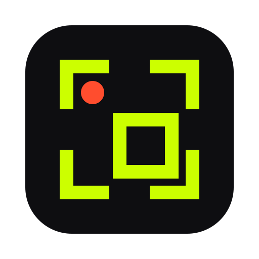
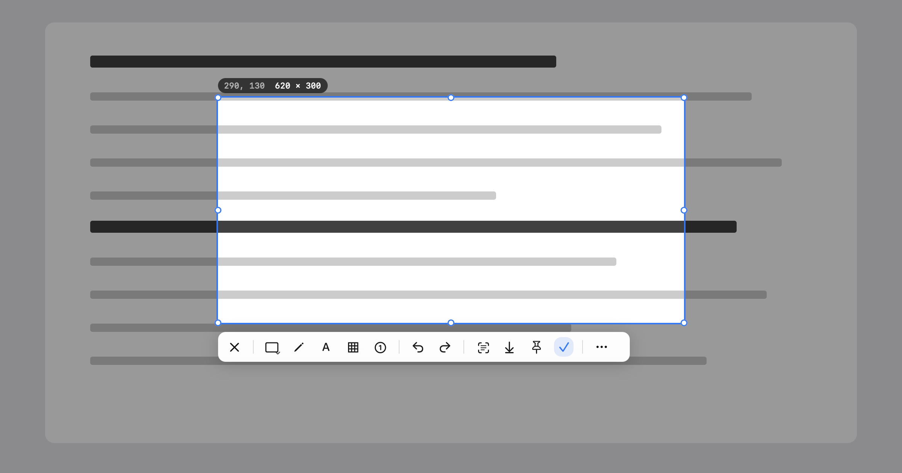

<p align="center">
  <a href="README.md">English</a> · <a href="README.zh-CN.md">简体中文</a> · <a href="README.zh-TW.md">繁體中文</a> · <b>日本語</b>
</p>

<p align="center">
  
</p>

<h1 align="center">Clip</h1>

<p align="center">
  ⌘を2回タップ。それで撮れます。<br>
  スクリーンショット、画面収録、テキスト認識。すべてMacの中で。
</p>

<p align="center">
  <a href="https://github.com/chengffei/clip/releases/latest/download/Clip-0.8.0.dmg"><b>ダウンロード</b></a> ·
  <a href="https://chengffei.github.io/clip/">ウェブサイト</a> ·
  <a href="#ソースからビルド">ソースからビルド</a>
</p>

<p align="center">
  
</p>

## あなたの画面は、あなたのもの。

スクリーンショットには何が写るかわかりません。プライベートなメッセージ、口座の残高、送る前のメール。だからClipは、そのすべてをMacの中に残します。サインインするアカウントも、アップロードされるものもありません。Clipがネットにつながるのは「Check for Updates…」をクリックしたときだけです。

## 1回目で、もう始まっている。

⌘の1回目を離した瞬間に、Clipは撮影を始めます。2回目を押すころには、止まった画面がもう用意できています。終わったら⌘をもう一度2回押せば、クリップボードに入ります。

## Visionが読めない文字も。

動画の一コマ、選択できないPDF、送られてきた画像からも文字を取り出せます。まずApple Visionが読み取り、読めなければClipの内蔵モデルがもう一度。すべてMacの上で動きます。

## スクリーンショットだけじゃない。

Clipは無料。中の機能も、すべて無料です。

- 矢印、四角、番号、モザイクで書き込み。コピーするまで、どれも直せます。
- 囲んだ範囲をMP4で録画。チャットでそのまま再生できるGIFにも。
- 長いページや会話はスクロールするだけ。Clipがつなぎ合わせ、固定ヘッダーは繰り返しません。
- キャプチャを全ウインドウの上にピン留めして参考に。画面上の色はポイントするだけで拾えます。
- ウインドウにポインタを合わせると、Clipがピクセル単位で縁取り。どのディスプレイでも。
- よく使うツールはツールバーに、残りは「More」へ。
- ネイティブAppKit、約15 MB。AppleシリコンとIntelに対応。

## ほかのツールとの違い

Shottrは小さいけれど録画できません。CleanShot Xはいちばん多機能で35ドル。PixPinは無料で多機能ですが、ソースは非公開で127 MB。Clipは無料、オープンソースで、ふだんはオフライン。詳しい比較は[ウェブサイト](https://chengffei.github.io/clip/#compare)で。

## インストール

1. [Clip-0.8.0.dmg](https://github.com/chengffei/clip/releases/latest/download/Clip-0.8.0.dmg)をダウンロードし、Clipを「アプリケーション」にドラッグします。
2. Clipは署名済みですがAppleの公証を受けていないため、初回起動時にmacOSにブロックされます。一度開いて警告を閉じたあと、「システム設定 › プライバシーとセキュリティ」で「このまま開く」をクリックしてください。または「ターミナル」で次のコマンドを一度実行すれば、そのまま開けます。

   ```sh
   xattr -dr com.apple.quarantine /Applications/Clip.app
   ```
3. 求められる2つのアクセス権を許可します。⌘の2回押しには「アクセシビリティ」、キャプチャには「画面収録」が必要です。

macOS 14以降が必要です。インターフェイスは現在、英語と簡体字中国語のみです。日本語環境では英語で表示されます。

## ショートカット

| 操作 | デフォルト |
|---|---|
| 範囲のスクリーンショット | ⌘を2回 |
| 選択中にクリップボードへコピー | ⌘を2回 |
| 収録、OCR、画像内テキストのコピー、ピン、全画面、カラーピッカー | Settings › Shortcuts で設定 |

エディタの各ツールには1キーのショートカットがあります。たとえばRは四角形、Aは矢印、Tはテキスト。ツールにポインタを合わせると確認できます。

## ソースからビルド

Xcode 26以降が必要です。Command Line Toolsだけでは、アクセス権パネルで使っているSwiftUIマクロをビルドできません。

```sh
bash scripts/rebuild-and-open.sh   # ビルド、署名、/Applicationsにインストールして起動
bash scripts/make-release.sh       # ユニバーサル版 → dist/Clip-<バージョン>.dmg と .zip
swift test                         # 180以上のテスト。CLIP_SNAPSHOT_DIR=ディレクトリ でツールバー、選択範囲、設定画面のPNGも出力
```

トリガーの診断ログは `~/Library/Logs/Clip/clip.log` に書き出されます。`Clip --diagnose` でアクセス権の状態を表示できます（画面収録の状態はFinderから起動したときのみ正確です）。

## クレジット

内蔵のテキスト認識モデルは、[PaddleOCR](https://github.com/PaddlePaddle/PaddleOCR)のPP-OCRv6 small（Apache-2.0）をCore MLに変換したものです。詳しくは `Resources/OCRModels/NOTICE` をご覧ください。

## ライセンス

[MIT](LICENSE)
