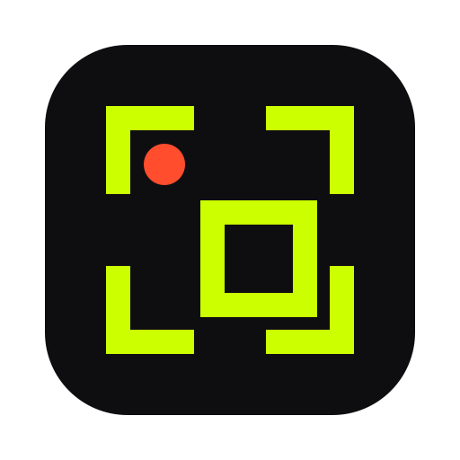
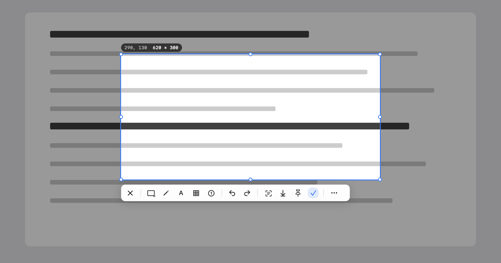

<p align="center">
  <b>English</b> · <a href="README.zh-CN.md">简体中文</a> · <a href="README.zh-TW.md">繁體中文</a> · <a href="README.ja.md">日本語</a>
</p>

<p align="center">
  
</p>

<h1 align="center">Clip</h1>

<p align="center">
  Double-tap ⌘. Frame it. Done.<br>
  Screenshots, screen recording and text recognition, right in your menu bar.
</p>

<p align="center">
  <a href="https://github.com/chengffei/clip/releases/latest/download/Clip-0.4.0.dmg"><b>Download</b></a> ·
  <a href="https://chengffei.github.io/clip/">Website</a> ·
  <a href="#build-from-source">Build from source</a>
</p>

<p align="center">
  
</p>

## Less, on purpose.

Screenshot tools keep adding cloud sync, teams and subscriptions. Clip does three things and stays out of the way: capture, record and recognize text. No account. No telemetry. Everything stays on your Mac.

## Features

**Capture in a tap.** Double-tap ⌘ anywhere. Windows snap into place, selections are pixel-precise, and every display works.

**Mark it up.** Rectangle, ellipse, arrow, line, pen, highlighter, mosaic, numbered markers and text. Every mark stays editable, with undo and redo.

**Record just the part you need.** Record the region you selected as MP4 or GIF. A small HUD lets you pause and stop.

**Copy text from anything.** Recognition runs on your Mac. Apple Vision reads it first, and a built-in model steps in when Vision comes up empty. One click puts the text on your clipboard.

**Go long.** Start a scrolling capture and scroll. Clip stitches as you go, and fixed headers and footers appear only once.

**Pin, pick, rotate.** Keep a capture floating above your windows, pick any color on screen, or turn an image in one click.

**One toolbar, arranged your way.** Cancel on the left, tools in the middle, results on the right. Move any tool to the bar, the More menu or out of sight, and add dividers wherever you like.

**Made for the Mac.** Native AppKit. One universal app for Apple silicon and Intel.

## Install

1. Download [Clip-0.4.0.dmg](https://github.com/chengffei/clip/releases/latest/download/Clip-0.4.0.dmg) and drag Clip into Applications.
2. Clip is signed but not notarized, so macOS blocks the first launch. Open it, close the warning, then click **Open Anyway** in *System Settings › Privacy & Security*. Or run this once in Terminal and open Clip as usual:

   ```sh
   xattr -dr com.apple.quarantine /Applications/Clip.app
   ```
3. Allow two permissions when asked: **Accessibility** for the ⌘⌘ trigger and **Screen Recording** for capture.

Requires macOS 14 or later.

## Shortcuts

| Action | Default |
|---|---|
| Region screenshot | ⌘ ⌘ (double-tap) |
| Copy to clipboard while selecting | ⌘ ⌘ |
| Record, OCR, copy image text, pin, full screen, color picker | Set in Settings › Shortcuts |

Editor tools have single-key shortcuts, such as R for rectangle, A for arrow and T for text. Hover a tool to see its key.

## Build from source

Requires Xcode 26 or later. The Command Line Tools alone can't build the SwiftUI macros used by the permission panel.

```sh
bash scripts/rebuild-and-open.sh   # build, sign, install to /Applications, launch
bash scripts/make-release.sh       # universal release → dist/Clip-<version>.dmg and .zip
swift test                         # 180+ tests; CLIP_SNAPSHOT_DIR=dir also writes toolbar/selection/settings PNGs
```

Trigger diagnostics are written to `~/Library/Logs/Clip/clip.log`. `Clip --diagnose` prints the permission state (Screen Recording is only accurate when launched from Finder).

## Credits

Clip is a fork of [capcap](https://github.com/realskyrin/capcap) by realskyrin (MIT). The capture engine, editor and recording pipeline come from there. Clip changes the identity, the permission flow and the look, and removes what one person doesn't need: cloud upload, translation, image merge, history, the agent CLI, auto-update, countdown, QR and beautify.

The built-in text recognition model is PP-OCRv6 small from [PaddleOCR](https://github.com/PaddlePaddle/PaddleOCR) (Apache-2.0), converted to Core ML. See `Resources/OCRModels/NOTICE`.

## License

[MIT](LICENSE)
