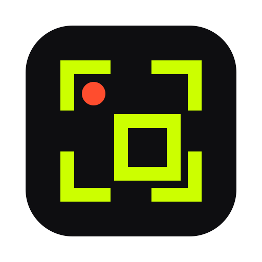
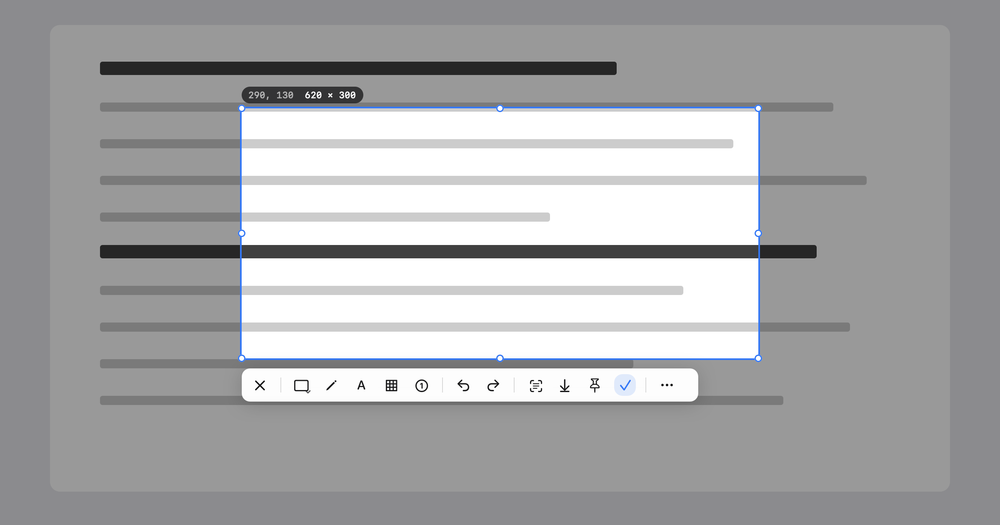

<p align="center">
  <b>English</b> · <a href="README.zh-CN.md">简体中文</a> · <a href="README.zh-TW.md">繁體中文</a> · <a href="README.ja.md">日本語</a>
</p>

<p align="center">
  
</p>

<h1 align="center">Clip</h1>

<p align="center">
  Tap ⌘ twice. Get the shot.<br>
  Screenshots, screen recording and text recognition for Mac, all on device.<br><br>
  A free, open-source screenshot, screen recording and OCR tool for Mac. An alternative to CleanShot X and Shottr.
</p>

<p align="center">
  <a href="https://github.com/chengffei/clip/releases/latest/download/Clip-0.8.0.dmg"><b>Download</b></a> ·
  <a href="https://chengffei.github.io/clip/">Website</a> ·
  <a href="#build-from-source">Build from source</a>
</p>

<p align="center">
  
</p>

## Your screen stays yours.

A screenshot can catch anything: a private message, a bank balance, an email you haven’t sent. So Clip keeps every one of them on your Mac. There’s no account to sign in to and nothing to upload. Clip connects to the internet only when you click Check for Updates.

## Quick from the first tap.

Clip starts capturing as your first tap of ⌘ lifts, so the frozen screen is ready by the time the second one lands. When you’re done, double-tap ⌘ again and the shot is on your clipboard.

## Reads text, even when Vision can’t.

Pull the words out of a video frame, a locked PDF or an image someone sent you. Apple Vision reads it first. If it comes up empty, Clip’s built-in model takes another pass, right on your Mac.

## More than a screenshot.

Clip is free, and so is everything in it.

- Mark up with arrows, boxes, numbered steps and mosaic, and change any mark until you copy.
- Record the area you framed as an MP4, or as a GIF that plays right in a chat.
- Scroll through a long page or conversation and Clip stitches it as you go, without repeating sticky headers.
- Pin a capture above your windows while you work, and pick any color on screen.
- Hover a window and Clip outlines it to the pixel, on any display.
- Keep the tools you use on the toolbar and tuck the rest into More.
- Native AppKit, about 15 MB, for Apple silicon and Intel.

## How it compares

Shottr is small but can’t record. CleanShot X does the most, for $35. PixPin is free and full of features, but closed source and 127 MB. Clip is free, open source and stays offline. See the [full table](https://chengffei.github.io/clip/#compare).

## Install

1. Download [Clip-0.8.0.dmg](https://github.com/chengffei/clip/releases/latest/download/Clip-0.8.0.dmg) and drag Clip into Applications.
2. Clip is signed but not notarized, so macOS blocks the first launch. Open it, close the warning, then click **Open Anyway** in *System Settings › Privacy & Security*. Or run this once in Terminal and open Clip as usual:

   ```sh
   xattr -dr com.apple.quarantine /Applications/Clip.app
   ```
3. Allow two permissions when asked: **Accessibility** for the ⌘⌘ trigger and **Screen Recording** for capture.

Requires macOS 14 or later.

## Shortcuts

| Action | Default |
|---|---|
| Region screenshot | ⌘ ⌘ (double-tap) |
| Copy to clipboard while selecting | ⌘ ⌘ |
| Record, OCR, copy image text, pin, full screen, color picker | Set in Settings › Shortcuts |

Editor tools have single-key shortcuts, such as R for rectangle, A for arrow and T for text. Hover a tool to see its key.

## Build from source

Requires Xcode 26 or later. The Command Line Tools alone can't build the SwiftUI macros used by the permission panel.

```sh
bash scripts/rebuild-and-open.sh   # build, sign, install to /Applications, launch
bash scripts/make-release.sh       # universal release → dist/Clip-<version>.dmg and .zip
swift test                         # 180+ tests; CLIP_SNAPSHOT_DIR=dir also writes toolbar/selection/settings PNGs
```

Trigger diagnostics are written to `~/Library/Logs/Clip/clip.log`. `Clip --diagnose` prints the permission state (Screen Recording is only accurate when launched from Finder).

## Credits

The built-in text recognition model is PP-OCRv6 small from [PaddleOCR](https://github.com/PaddlePaddle/PaddleOCR) (Apache-2.0), converted to Core ML. See `Resources/OCRModels/NOTICE`.

## License

[MIT](LICENSE)
