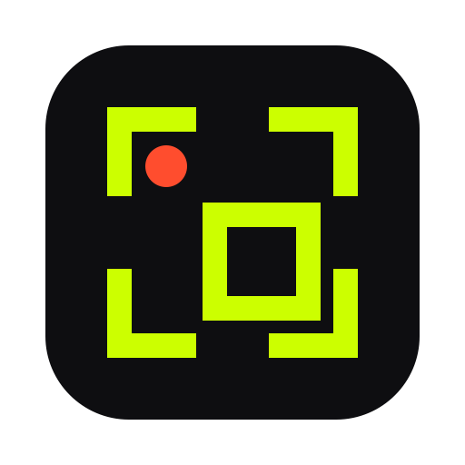
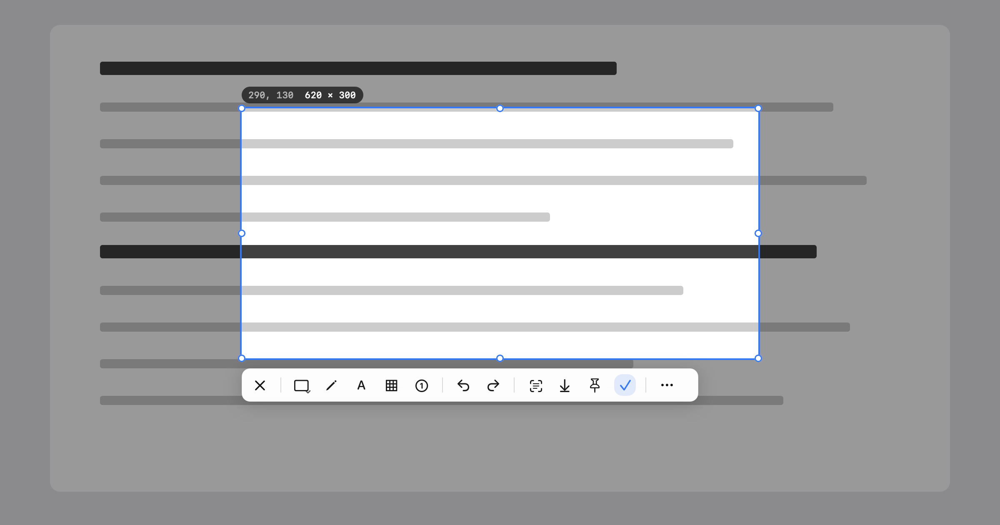

<p align="center">
  <a href="README.md">English</a> · <b>简体中文</b> · <a href="README.zh-TW.md">繁體中文</a> · <a href="README.ja.md">日本語</a>
</p>

<p align="center">
  
</p>

<h1 align="center">Clip</h1>

<p align="center">
  按两下 ⌘，截图就到手。<br>
  截图、录屏、识别文字，都在你的 Mac 上完成。
</p>

<p align="center">
  <a href="https://github.com/chengffei/clip/releases/latest/download/Clip-0.8.1.dmg"><b>下载</b></a> ·
  <a href="https://chengffei.github.io/clip/">官网</a> ·
  <a href="#从源码构建">从源码构建</a>
</p>

<p align="center">
  
</p>

## 你的屏幕，只归你。

截图里什么都可能有：私信、银行余额、还没发出去的邮件。所以 Clip 把每一张都留在你的 Mac 上。不用登录账号，也没有东西会上传。只有你点「检查更新」时，Clip 才会联网。

## 第一下松开，就开始了。

第一下 ⌘ 抬起时，Clip 就开始截屏；等第二下落下，定格的画面已经准备好了。截完再按两下 ⌘，截图就进了剪贴板。

## Vision 认不出的，它也能认。

视频里的一帧、选不中文字的 PDF、别人发来的图片，都能把文字取出来。Apple Vision 先读；读不出来，Clip 内置的模型再试一次，全程在本机。

## 不止是截图。

Clip 免费，里面每个功能也都免费。

- 用箭头、方框、步骤序号和马赛克标注，复制之前每一笔都能再改。
- 把框好的区域录成 MP4，或录成在聊天里直接播放的 GIF。
- 长网页、长聊天记录，滚动一遍就截下来；Clip 边滚边拼，吸顶的标题栏只出现一次。
- 把截图钉在所有窗口上方当参考，屏幕上任何颜色指一下就能取。
- 指针移到窗口上，Clip 沿边缘描出来，精确到像素，哪块屏幕都一样。
- 常用工具放在工具栏上，其余的收进「更多」。
- 原生 AppKit，约 15 MB，Apple 芯片和 Intel 都能用。

## 对比

Shottr 小巧，但不能录屏。CleanShot X 功能最全，售价 35 美元。PixPin 免费、功能多，但闭源，安装包 127 MB。Clip 免费、开源，平时也不联网。完整对比见[官网](https://chengffei.github.io/clip/#compare)。

## 安装

1. 下载 [Clip-0.8.1.dmg](https://github.com/chengffei/clip/releases/latest/download/Clip-0.8.1.dmg)，把 Clip 拖进「应用程序」。
2. Clip 已签名但未经 Apple 公证，首次打开会被 macOS 拦下。先打开一次并关掉提示，再到「系统设置 › 隐私与安全性」点「仍要打开」。也可以在「终端」里运行一次下面的命令，之后正常打开即可：

   ```sh
   xattr -dr com.apple.quarantine /Applications/Clip.app
   ```
3. Clip 会申请两项权限，都要允许：「辅助功能」用于连按 ⌘ 触发，「屏幕录制」用于截图和录屏。

需要 macOS 14 或更高版本。界面支持简体中文和英文。

## 快捷键

| 操作 | 默认 |
|---|---|
| 区域截图 | 连按两下 ⌘ |
| 选区时复制到剪贴板 | 连按两下 ⌘ |
| 录屏、OCR、复制图中文字、贴图、全屏、取色 | 在「设置 › 快捷键」中设置 |

编辑器里的工具都有单键快捷键，比如 R 是矩形，A 是箭头，T 是文字。鼠标停在工具上就能看到。

## 从源码构建

需要 Xcode 26 或更高版本。只装 Command Line Tools 无法编译权限面板用到的 SwiftUI 宏。

```sh
bash scripts/rebuild-and-open.sh   # 编译、签名、装到 /Applications 并启动
bash scripts/make-release.sh       # 通用发行包 → dist/Clip-<版本>.dmg 和 .zip
swift test                         # 180 多个测试；设置 CLIP_SNAPSHOT_DIR=目录 还会输出工具栏、选区、设置页截图
```

触发诊断日志写在 `~/Library/Logs/Clip/clip.log`。`Clip --diagnose` 会打印权限状态（从 Finder 启动时，屏幕录制的状态才准确）。

## 致谢

内置的文字识别模型是 [PaddleOCR](https://github.com/PaddlePaddle/PaddleOCR) 的 PP-OCRv6 small（Apache-2.0），已转换为 Core ML，详见 `Resources/OCRModels/NOTICE`。

## 参与贡献

欢迎贡献。提交代码前需要同意[贡献者许可协议](CLA.md)。

## 许可

[GPL-3.0](LICENSE)。Clip 由 capcap（MIT）分叉而来，见 [THIRD_PARTY_NOTICES.md](THIRD_PARTY_NOTICES.md)。
