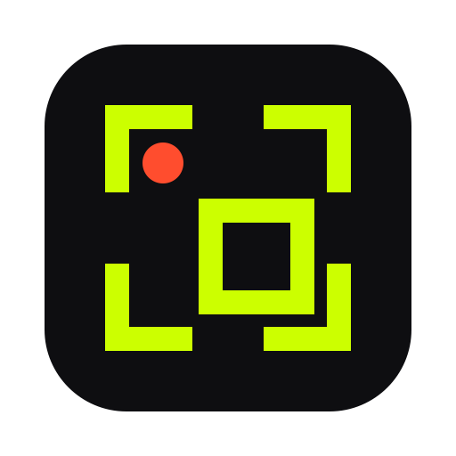
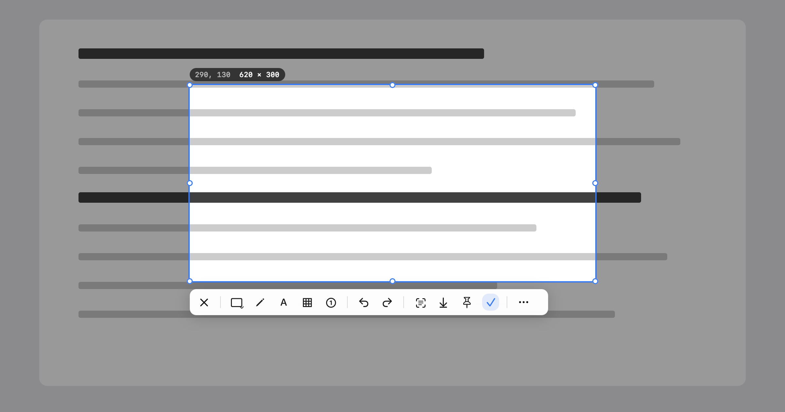

<p align="center">
  <a href="README.md">English</a> · <a href="README.zh-CN.md">简体中文</a> · <b>繁體中文</b> · <a href="README.ja.md">日本語</a>
</p>

<p align="center">
  
</p>

<h1 align="center">Clip</h1>

<p align="center">
  按兩下 ⌘，截圖就到手。<br>
  截圖、螢幕錄影、文字辨識，都在你的 Mac 上完成。
</p>

<p align="center">
  <a href="https://github.com/chengffei/clip/releases/latest/download/Clip-0.8.1.dmg"><b>下載</b></a> ·
  <a href="https://chengffei.github.io/clip/">網站</a> ·
  <a href="#從原始碼建置">從原始碼建置</a>
</p>

<p align="center">
  
</p>

## 你的螢幕，只屬於你。

截圖裡什麼都可能有：私訊、銀行餘額、還沒寄出的郵件。所以 Clip 把每一張都留在你的 Mac 上。不用登入帳號，也沒有東西會上傳。只有你按「檢查更新」時，Clip 才會連網。

## 第一下放開，就開始了。

第一下 ⌘ 放開時，Clip 就開始擷取畫面；等第二下按下，定格的畫面已經準備好了。截完再按兩下 ⌘，截圖就進了剪貼簿。

## Vision 辨識不出的，它也行。

影片裡的一格畫面、選不到文字的 PDF、別人傳來的圖片，都能把文字取出來。Apple Vision 先讀；讀不出來，Clip 內建的模型再試一次，全程在本機。

## 不只是截圖。

Clip 免費，裡面每個功能也都免費。

- 用箭頭、方框、步驟編號和馬賽克標註，複製之前每一筆都能再改。
- 把框好的範圍錄成 MP4，或錄成能在聊天裡直接播放的 GIF。
- 長網頁、長聊天紀錄，捲動一遍就截下來；Clip 邊捲邊拼接，置頂的標題列只出現一次。
- 把截圖釘在所有視窗上方當參考，螢幕上任何顏色指一下就能取。
- 指標移到視窗上，Clip 沿邊緣描出來，精確到像素，哪部顯示器都一樣。
- 常用工具放在工具列上，其餘的收進「更多」。
- 原生 AppKit，約 15 MB，Apple 晶片和 Intel 都能用。

## 比較

Shottr 小巧，但不能錄影。CleanShot X 功能最完整，售價 35 美元。PixPin 免費、功能多，但不開源，安裝檔 127 MB。Clip 免費、開源，平時也不連網。完整比較見[網站](https://chengffei.github.io/clip/#compare)。

## 安裝

1. 下載 [Clip-0.8.1.dmg](https://github.com/chengffei/clip/releases/latest/download/Clip-0.8.1.dmg)，把 Clip 拖進「應用程式」。
2. Clip 已簽署但未經 Apple 公證，首次開啟會被 macOS 擋下。先開啟一次並關閉提示，再到「系統設定 › 隱私權與安全性」按「強制打開」。也可以在「終端機」裡執行一次下面的指令，之後正常開啟即可：

   ```sh
   xattr -dr com.apple.quarantine /Applications/Clip.app
   ```
3. Clip 會要求兩項權限，都要允許：「輔助使用」用於連按 ⌘ 觸發，「螢幕錄製」用於截圖和錄影。

需要 macOS 14 或以上版本。介面目前只有簡體中文和英文，繁體中文系統會顯示簡體中文。

## 快速鍵

| 動作 | 預設 |
|---|---|
| 範圍截圖 | 連按兩下 ⌘ |
| 選取時拷貝到剪貼簿 | 連按兩下 ⌘ |
| 錄影、OCR、拷貝圖中文字、釘選、全螢幕、取色 | 在「設定 › 快捷鍵」中設定 |

編輯器裡的工具都有單鍵快速鍵，例如 R 是矩形，A 是箭頭，T 是文字。滑鼠停在工具上就能看到。

## 從原始碼建置

需要 Xcode 26 或以上版本。只裝 Command Line Tools 無法編譯權限面板用到的 SwiftUI 巨集。

```sh
bash scripts/rebuild-and-open.sh   # 編譯、簽署、安裝到 /Applications 並啟動
bash scripts/make-release.sh       # 通用發行包 → dist/Clip-<版本>.dmg 和 .zip
swift test                         # 180 多個測試；設定 CLIP_SNAPSHOT_DIR=目錄 還會輸出工具列、選取範圍、設定頁截圖
```

觸發診斷記錄寫在 `~/Library/Logs/Clip/clip.log`。`Clip --diagnose` 會印出權限狀態（從 Finder 啟動時，螢幕錄製的狀態才準確）。

## 致謝

內建的文字辨識模型是 [PaddleOCR](https://github.com/PaddlePaddle/PaddleOCR) 的 PP-OCRv6 small（Apache-2.0），已轉換為 Core ML，詳見 `Resources/OCRModels/NOTICE`。

## 參與貢獻

歡迎貢獻。提交程式碼前需要同意[貢獻者授權協議](CLA.md)。

## 授權

[GPL-3.0](LICENSE)。Clip 由 capcap（MIT）分支而來，見 [THIRD_PARTY_NOTICES.md](THIRD_PARTY_NOTICES.md)。
